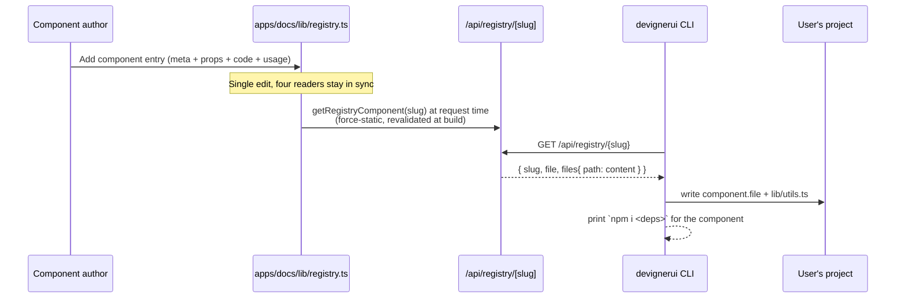
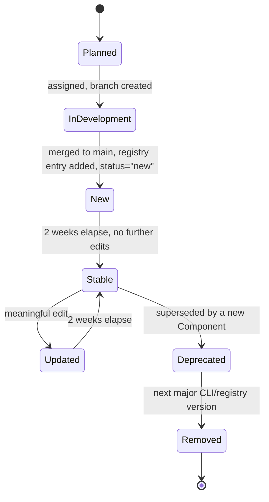
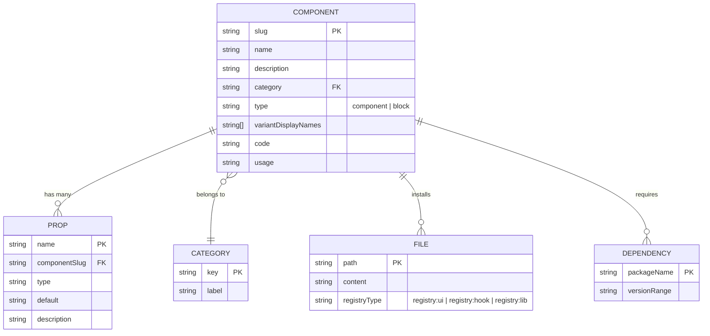
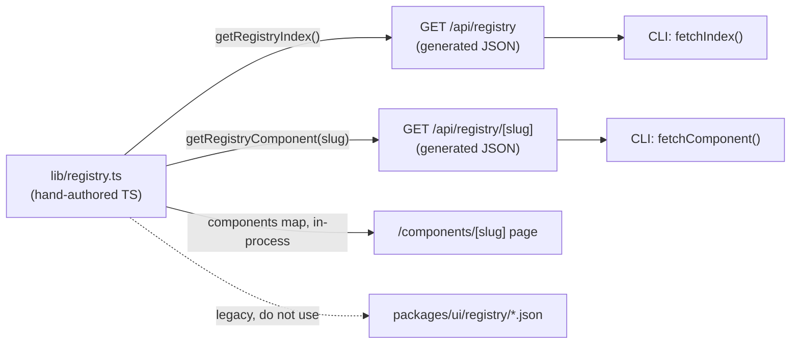
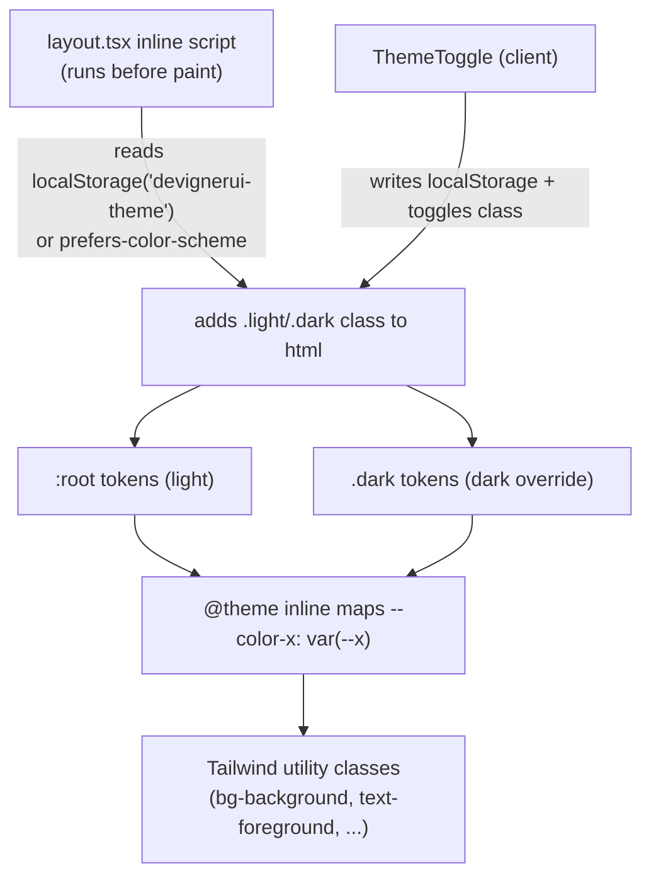
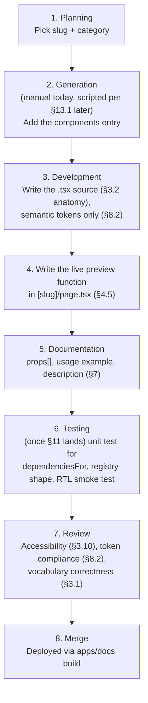

# Devigner UI — Single Source of Truth (SSOT)

> **Status:** Authoritative. Every implementation decision in this repository must conform to this document. If code and this document disagree, the code is wrong — fix the code, or open a PR that amends this document first and migrates the code in the same change.
>
> **Version:** 1.0.0 · **Last updated:** 2026-07-01 · **Owner:** Devigner UI core team

This document is the **single place** a developer or an AI assistant should need to read to understand, extend, or operate on this codebase without asking "how do we usually do this here?" Anything not covered here should be resolved by the *closest matching precedent already in this document*, not by inventing a new pattern.

---

## Table of Contents

1. [Project Overview](#1-project-overview)
2. [Architecture](#2-architecture)
3. [Component System](#3-component-system)
4. [Dynamic Data Model](#4-dynamic-data-model)
5. [TypeScript Standards](#5-typescript-standards)
6. [Data Layer](#6-data-layer)
7. [Documentation Standards](#7-documentation-standards)
8. [Styling System](#8-styling-system)
9. [Code Standards](#9-code-standards)
10. [Performance](#10-performance)
11. [Testing](#11-testing)
12. [Scalability](#12-scalability)
13. [Automation](#13-automation)
14. [Development Workflow](#14-development-workflow)
15. [Project Conventions](#15-project-conventions)
16. [Future Roadmap](#16-future-roadmap)
17. [Known Drift & Mandated Fixes](#17-known-drift--mandated-fixes)

---

## 1. Project Overview

### 1.1 Vision

Devigner UI is a **copy-paste-first React component distribution system**: a Tailwind CSS v4 component library that ships through a CLI (`npx devignerui add <component>`), not through `npm install` of a component package. Every component has **exactly one canonical implementation** (the multi-Style model was removed 2026-07-05 — one polished treatment per component, differentiated by quality and motion rather than by parallel visual treatments). Users own the code that lands in their repository; Devigner UI owns the catalog, the docs site, and the CLI that delivers it.

### 1.2 Goals

- Provide a growing catalog of production-quality, accessible, animated components and marketing blocks — one finished implementation each.
- Let a developer go from zero to a styled, working component in their own codebase in under 60 seconds via the CLI.
- Monetize via tiered components (free vs. Pro) and a documentation/showcase site, without gating the *act* of browsing or reading code.
- Keep the component source the user receives **dependency-light and framework-idiomatic** — no runtime coupling to a `@devignerui/ui` import once installed via CLI (the npm package `@devignerui/ui` exists for direct-import use cases, but the CLI path is primary and copies source, not the compiled package).

### 1.3 Target Audience

- Frontend developers and small agencies shipping Tailwind v4 + React 19 products who want a head start beyond raw shadcn/ui primitives, particularly motion-heavy marketing surfaces (hero sections, pricing, etc.).
- Secondary: teams already on shadcn/ui who want additional design treatments without forking.

### 1.4 Scope

In scope: the component registry/catalog, the CLI installer, the documentation/showcase site, monetization (Creem-based licensing), and the `@devignerui/ui` npm package as a secondary distribution channel.

Out of scope (for now, see [§16](#16-future-roadmap) for the path to bring these in): non-React frameworks (Vue, Svelte), a hosted design-token editor, a visual no-code builder, self-serve theme marketplace.

### 1.5 Core Principles

1. **One data model, many consumers.** Component content (code, props, metadata) is authored exactly once and read by the docs site, the public registry API, and the CLI. Never hand-author the same component twice in two formats.
2. **Semantic tokens, never literals.** Component source code references CSS custom properties (`bg-background`, `text-foreground`, `shadow-card`) — never hex/oklch literals or Tailwind's raw palette (`bg-white`, `bg-blue-500`) outside of intentional one-off decorative treatments that are explicitly part of a component's identity.
3. **Copy-paste must be self-contained.** Every file the CLI writes must compile against nothing but: React, the project's own `cn()` util, and the npm dependencies explicitly listed for that component. No silent dependency on `@devignerui/ui` internals.
4. **Strict TypeScript everywhere, no exceptions.** Every package compiles under `strict: true`. This is already true across all four packages and must stay true.
5. **The docs site is the registry.** `apps/docs` is not just a presentation layer — `apps/docs/lib/registry.ts` is the canonical data source that the public API, the CLI, and the rendered docs pages all read from.
6. **Boring over clever.** Component implementations favor `forwardRef` + CVA + Tailwind over novel abstractions. New patterns require a precedent-setting decision recorded in this document (§3.6), not silent invention per-component.

### 1.6 Non-Goals

- Devigner UI is **not** a general-purpose design-token platform or theming SaaS.
- Devigner UI does **not** attempt framework-agnostic output (no Vue/Svelte codegen) in the current phase.
- Devigner UI does **not** ship a runtime component picker/visual editor.
- The `@devignerui/ui` npm package is **not** the primary install path — it exists for consumers who explicitly prefer "real" npm dependency over copy-paste, and must stay a thin, optional mirror of the same component source, never a divergent implementation.

---

## 2. Architecture

### 2.1 High-Level Architecture

Devigner UI is a **pnpm + Turborepo monorepo** with four packages. There is exactly one direction of truth: component content flows *out of* `apps/docs/lib/registry.ts`, never into it from the CLI or the npm package.

```mermaid
flowchart TB
    subgraph SOURCE["Source of Truth"]
        REG["apps/docs/lib/registry.ts<br/>(components, props, code)"]
    end

    subgraph DOCS["@devignerui/docs (Next.js 15 App Router)"]
        PAGE["/components/[slug] page"]
        APIIDX["GET /api/registry"]
        APISLUG["GET /api/registry/[slug]"]
    end

    subgraph CLI["@devignerui/cli"]
        FETCH["registry.ts (HTTP client)"]
        ADD["add command"]
        LIST["list command"]
        INIT["init command"]
    end

    subgraph NPM["@devignerui/ui (npm package)"]
        COMPONENTS["src/components/*.tsx<br/>(curated mirror)"]
    end

    subgraph SHARED["@devignerui/shared"]
        TYPES["types.ts, constants.ts"]
    end

    REG --> PAGE
    REG --> APIIDX
    REG --> APISLUG
    APIIDX --> FETCH
    APISLUG --> FETCH
    FETCH --> ADD
    FETCH --> LIST
    INIT -.writes components.json.-> USERPROJECT["User's project"]
    ADD -.writes .tsx + lib/utils.ts.-> USERPROJECT
    COMPONENTS -.npm install, optional path.-> USERPROJECT
    SHARED -.shared types.-> CLI
    SHARED -.shared types.-> NPM
```

**Why this shape:** the CLI must never read a local file inside the monorepo — it only ever talks HTTP to the deployed docs site's API (`DEVIGNER_REGISTRY_URL`, defaulting to `https://devignerui.com/api/registry`). This means the CLI works identically whether run from inside this monorepo or installed globally by an end user, and the docs deploy is the only thing that needs to ship for the catalog to update.

### 2.2 Folder Structure

```
devignerui/
├── apps/
│   └── docs/                        # @devignerui/docs — Next.js 15 App Router site
│       ├── app/
│       │   ├── api/
│       │   │   ├── registry/route.ts            # GET index — reads lib/registry.ts
│       │   │   ├── registry/[slug]/route.ts     # GET one component — reads lib/registry.ts
│       │   │   ├── checkout/route.ts            # Creem checkout session
│       │   │   ├── license/route.ts             # Creem license validation
│       │   │   └── webhook/route.ts             # Creem webhook receiver
│       │   ├── components/page.tsx              # Catalog grid
│       │   ├── components/[slug]/page.tsx       # Component detail (preview/code/install/props)
│       │   ├── pricing/                         # Pricing page (anchors to home for now)
│       │   ├── checkout/                        # Post-checkout flow
│       │   ├── layout.tsx                       # Root layout, theme bootstrap script
│       │   └── globals.css                      # CANONICAL design tokens (see §8)
│       ├── components/                          # Docs-site-only UI (not distributed)
│       │   ├── code-block.tsx
│       │   ├── copy-button.tsx
│       │   └── theme-provider.tsx
│       ├── content/                              # Reserved for Fumadocs MDX (currently unused — see §17)
│       ├── lib/
│       │   ├── registry.ts                       # CANONICAL data source (see §4, §6)
│       │   └── creem.ts                          # Payments/licensing client
│       └── public/
│
├── packages/
│   ├── ui/                          # @devignerui/ui — npm-distributable mirror
│   │   ├── src/
│   │   │   ├── components/*.tsx     # forwardRef components, one per registry slug
│   │   │   ├── hooks/
│   │   │   ├── lib/{utils.ts,animations.ts}
│   │   │   └── styles/globals.css   # MUST mirror apps/docs/app/globals.css token-for-token
│   │   ├── registry/*.json          # LEGACY — scheduled for removal, see §17
│   │   └── package.json
│   │
│   ├── cli/                         # @devignerui/cli — npm-distributable installer
│   │   ├── src/
│   │   │   ├── index.ts             # Commander entrypoint
│   │   │   ├── registry.ts          # Thin HTTP client against the docs API
│   │   │   └── commands/{init,add,list}.ts
│   │   └── package.json
│   │
│   └── shared/                      # @devignerui/shared — cross-package types/constants
│       └── src/{types.ts,constants.ts}
│
├── docs/plans/                      # Historical planning docs (not authoritative — this file is)
├── pnpm-workspace.yaml
├── turbo.json
├── eslint.config.mjs                # Per-package Tailwind entry points (see §8.7)
└── SSOT.md                          # This file
```

**Rule:** a new top-level package goes in `packages/*` (publishable units) or `apps/*` (deployable units). Never nest a package inside another package's `src/`.

### 2.3 Module Boundaries

| Package | May import from | May NOT import from | Reason |
|---|---|---|---|
| `@devignerui/shared` | nothing internal | any other internal package | It is the dependency floor; importing upward creates cycles. |
| `@devignerui/ui` | `@devignerui/shared` | `@devignerui/cli`, `apps/docs` | A component library must not depend on a CLI or an app. |
| `@devignerui/cli` | `@devignerui/shared` | `@devignerui/ui`, `apps/docs` | The CLI talks to the docs site over HTTP, never via a workspace import — it must behave the same whether installed globally or run in-repo. |
| `apps/docs` | `@devignerui/ui`, `@devignerui/shared` | `@devignerui/cli` | The docs site renders the library directly; it has no business invoking the installer. |

These boundaries are not enforced by tooling today (no `eslint-plugin-boundaries` / dependency-cruiser config exists). **Decision:** until the catalog exceeds ~50 components, boundaries are enforced by code review against this table. Past that point, add `dependency-cruiser` as part of CI (see [§13](#13-automation)).

### 2.4 Dependency Rules

- `apps/docs` depends on workspace packages via `workspace:*` (pnpm).
- The CLI depends on **zero** workspace packages at runtime except `@devignerui/shared` for types — it is published standalone and must keep its dependency tree minimal (`commander` only, today).
- No package depends on Node-only APIs except `@devignerui/cli` (filesystem) — `@devignerui/ui` must remain isomorphic (buildable for SSR/RSC).
- New runtime dependencies require: (a) it solves a problem Tailwind/React/the platform cannot solve in <20 lines, (b) it is added to the most specific package that needs it, never to the workspace root unless it's a dev tool shared by all packages (eslint, typescript-eslint, turbo).

### 2.5 Design Patterns

| Pattern | Where used | Why |
|---|---|---|
| **Variant-prop component (CVA)** | `Button`, `Badge` | Single component, multiple visual variants via a typed `variant`/`size` prop. Canonical for any component whose "variants" are just class-name swaps. |
| **Compound component family** | `Card` (`Card`, `CardHeader`, `CardTitle`, `CardDescription`, `CardContent`, `CardFooter`) | Each part is a styled primitive; composition happens in JSX, not via props drilling. Canonical for anything with header/body/footer-shaped structure. |
| **Variant-dispatcher block** | `HeroSection` (`variant: "centered" \| "split" \| "minimal"`) | A single public component whose `variant` prop switches between structurally different internal implementations. Canonical for marketing blocks where variants differ in layout, not just class names. |
| **One file per Component** | `button.tsx`, `card.tsx` | Each Component is exactly one installable `.tsx` file (`components/ui/<slug>.tsx`). Visual variation lives in CVA Variants inside that file, never in parallel implementations. |
| **Registry-as-code** | `apps/docs/lib/registry.ts` | The catalog is a typed TypeScript module, not hand-written JSON, so authoring gets autocomplete, type-checking, and refactor-safety. JSON is a *build output* of this module (`getRegistryIndex()`/`getRegistryComponent()`), never authored directly. |
| **Thin HTTP client** | `packages/cli/src/registry.ts` | The CLI has no business logic about component content — it fetches typed JSON and writes files. All catalog logic lives server-side. |

### 2.6 Data Flow



The docs page (`/components/[slug]`) reads `components` directly from `lib/registry.ts` (in-process, no HTTP) since it executes inside the same Next.js server. The CLI is the **only** consumer that goes over HTTP, because it is a separate, independently-versioned binary.

### 2.7 Rendering Strategy

- **Docs site:** Next.js 15 App Router, React Server Components by default; pages that need interactivity (copy buttons, tabs, scroll-spy) are explicit `"use client"` leaf components (`ComponentPage`, `ComponentsPage`). Keep the navbar, footer, and static marketing copy as Server Components wherever a page is split — `ComponentsPage`/`ComponentPage` are currently whole-page client components because of `useRouter`/local UI state; when splitting new pages, default to Server Component and push `"use client"` to the smallest leaf.
- **Registry API routes:** `export const dynamic = "force-static"` — the catalog is static at build time and revalidated on deploy, not on every request. `generateStaticParams()` pre-renders every known slug's `/api/registry/[slug]` route at build time.
- **Component library (`@devignerui/ui`):** framework-agnostic React components, server-renderable by default (no `"use client"` unless the component itself needs state/effects/motion — e.g. `HeroSection`'s entry animation).

### 2.8 State Management Strategy

- **No global state library.** There is no Redux/Zustand/Jotai in this repo and none should be added. Component-local state (`useState`) is sufficient for every interactive primitive (toggles, inputs, hover/spotlight effects).
- **Page-level UI state** (preview/code view, install tab, scroll-spy section) lives in the page component via `useState`/`useEffect`, scoped to that page. It does not need to survive navigation.
- **Theme state** (light/dark) is the one piece of state that must persist across the whole app and across reloads: it lives in `localStorage` (key `devignerui-theme`), is applied as a `.dark` class on `<html>` by an inline script in `layout.tsx` (to avoid a flash of incorrect theme), and is read/written by `ThemeProvider`/`ThemeToggle` in `apps/docs/components/theme-provider.tsx`.
- **Server state** (registry content) is not "state" at all from the client's perspective — it's data fetched once per request/build. Do not introduce React Query/SWR for the registry; it is static, cached at the HTTP layer (`Cache-Control: public, s-maxage=3600`), and re-fetched per CLI invocation, which is correct and sufficient.
- **Decision:** if a future feature needs cross-page client state (e.g. a cart, a logged-in user session), introduce React Context scoped to the smallest subtree that needs it before reaching for a state library. Only add a state library when more than one unrelated feature needs cross-cutting client state simultaneously.

---

## 3. Component System

### 3.1 Vocabulary (binding)

These three terms are used precisely and exclusively throughout this codebase and this document. Misusing them in code, commit messages, or docs is a defect. (A fourth term, **Style** — parallel installable implementations of one Component — existed until 2026-07-05 and was removed; each Component now has exactly one implementation.)

| Term | Definition | Example |
|---|---|---|
| **Component** | A conceptual UI element with one slug, one category, one props contract, one installable implementation. | `button`, `hero-section` |
| **Variant** | A CVA-driven prop value *within* a Component's API. Does not change which files are installed. | `variant="outline"` on Button |
| **Block** | A Component whose `type` is `"block"` rather than `"component"` — typically a marketing section composed from primitives. Otherwise follows all the same rules as a Component. | `hero-section` |

A CVA variant is never installed independently by the CLI.

### 3.2 Component Anatomy

Every Component ships as exactly one `.tsx` file plus the shared `lib/utils.ts`. The canonical anatomy:

```tsx
import * as React from "react";
import { cva, type VariantProps } from "class-variance-authority"; // only if the component has CVA variants
import { cn } from "@/lib/utils";

const xVariants = cva(/* base classes */, {
  variants: { /* ... */ },
  defaultVariants: { /* ... */ },
});

export interface XProps
  extends React.ComponentPropsWithoutRef<"element">,
    VariantProps<typeof xVariants> {}

const X = React.forwardRef<HTMLElementType, XProps>(
  ({ className, variant, size, ...props }, ref) => (
    <element
      ref={ref}
      className={cn(xVariants({ variant, size, className }))}
      {...props}
    />
  ),
);
X.displayName = "X";

export { X, xVariants };
```

Rules:
- `forwardRef` is **mandatory** for every leaf DOM-rendering component, so consumers can attach refs (focus management, Radix composition, animation libraries). The one accepted exception is a component whose **only** job is to switch between other forwardRef components (e.g. `HeroSection`'s variant dispatcher) — the leaf implementations still forward refs... but since `HeroSection` does not currently forward a ref, **new block components must add `forwardRef` on the outer dispatcher too**; this is a gap in the current `HeroSection` implementation to close opportunistically (not urgent, see §17).
- `className` is always the last thing merged via `cn()`, so consumer overrides win.
- `displayName` is set explicitly on every `forwardRef` component (React DevTools + debugging).
- Props interfaces are always exported, named `<Component>Props`.

### 3.3 Categories

Canonical category list, defined in `packages/shared/src/constants.ts` (`COMPONENT_CATEGORIES`):

| Key | Label | Examples |
|---|---|---|
| `primitives` | Primitives | Button, Card, Badge |
| `forms` | Forms | Input, Textarea, Select |
| `feedback` | Feedback | Toast, Alert, Skeleton |
| `navigation` | Navigation | Navbar, Tabs, Pagination |
| `overlays` | Overlays | Modal, Dropdown, Tooltip |
| `marketing` | Marketing Blocks | Hero Section, CTA, Testimonials |
| `animation` | Animation | (motion-only utility components) |
| `layout` | Layout | Container, Grid, Stack |

A Component has exactly one category. Adding a ninth category requires adding it to `COMPONENT_CATEGORIES` in `packages/shared/src/constants.ts` — never invent a category string ad hoc in `apps/docs/lib/registry.ts`'s `meta` map; the values there (currently human-readable strings like `"Primitives"`, `"Marketing"`) **must** resolve to a label in this table (see §17 for the current label-key mismatch to fix).

### 3.4 Subcategories

Not used today. **Decision:** do not add a subcategory field until a category exceeds ~25 components and filtering by category alone becomes unusable in the catalog grid. When that happens, add an optional `subcategory?: string` to `ComponentData` (additive, non-breaking — see §4.5).

### 3.5 Variants

Each Component ships exactly one implementation. Visual variation is expressed only as CVA Variants (`variant`/`size` props) inside that implementation — never as parallel installable files. (The multi-Style model — `gradient`, `magnetic`, `glass`, etc. as separate installable treatments — was removed 2026-07-05.)

### 3.6 Slots

This codebase does not use a slot API (no `asChild`-via-Radix-`Slot` pattern, no named-slot props object) today. `Button` briefly declared an unimplemented `asChild?: boolean` prop with zero callers anywhere in the repo; it was removed (§17.5) rather than implemented, since there was no concrete consumer need driving it — a typed-but-inert prop is worse than no prop. **Decision:** when composition needs actually grow (e.g. an icon-button wanting to render as a `Link`), adopt the shadcn/Radix `Slot` pattern (`@radix-ui/react-slot`) rather than inventing a custom named-slots object prop — it is the de facto standard for this exact problem and keeps API surface familiar to anyone coming from shadcn/ui. Do not re-add `asChild` ahead of a real call site.

### 3.7 Status / Lifecycle Field

Removed with the multi-Style model — the per-Style `status` field no longer exists in the registry. If per-Component lifecycle badges are wanted later, add an optional `status?: "new" | "updated" | "stable"` to `ComponentData` (additive, non-breaking).

### 3.8 Composition Patterns

1. **Atomic** — a Component is one element (`Input`, `Badge`). No composition.
2. **Compound** — a Component exports a family of subcomponents meant to be composed in JSX (`Card` + `CardHeader` + `CardTitle` + `CardContent` + `CardFooter`). Subcomponents never import each other; the consumer composes them.
3. **Slotted props** — a Component accepts other components as props rather than children (`HeroSection`'s `primaryAction`/`secondaryAction: ReactNode`). Used specifically so the Hero block doesn't have an opinion on which Button variant the consumer wants.

Pick the pattern by asking: *does this Component have an internal structure with named regions (compound), is it a single visual unit (atomic), or does it host other arbitrary components (slotted props)?*

### 3.9 Component Lifecycle



A Component is never silently deleted from the registry while any published CLI version can still request it — deprecate first (keep serving it, mark it in docs as deprecated with a migration note, see §7.7), remove only on a version boundary.

### 3.10 Accessibility Requirements

Non-negotiable for every Component shipped, enforced at PR review (no automated gate exists yet — see §11.5 for the plan to add one):

- Every interactive element is a real `<button>`, `<a>`, `<input>`, or has the correct ARIA role — never a `<div onClick>` in **distributed** component source. (Docs-site-only preview components, like the ones in `app/components/page.tsx`, are exempt since they are not shipped to consumers, but should still be fixed opportunistically.)
- `focus-visible:ring-2 focus-visible:ring-accent` (or equivalent) on every focusable element — this is already the established convention in `Button`, `Input`, `Badge`.
- Color contrast meets WCAG AA (4.5:1 body text, 3:1 large text/UI) against both the light and dark token sets — this is why tokens are organized as a text scale (`text-primary` → `text-muted`) rather than arbitrary grays (see §8.2).
- `prefers-reduced-motion: reduce` must disable/shorten non-essential motion. This is already handled globally in both `globals.css` files via a media query that zeroes animation/transition duration; **Motion (`motion/react`)-driven components must additionally call `useReducedMotion()`** and skip transform/opacity entrance animations when `true` (already the pattern in `apps/docs/app/components/page.tsx`'s `Reveal` helper — replicate it in any new Motion-based docs/marketing component, and prefer CSS transitions over Motion for distributed component source where Motion is not load-bearing to the effect, to avoid forcing the `motion` dependency on every consumer).
- Toggle-like components (checkbox/radio/switch previews) communicate state via `aria-checked`/`aria-pressed`, not color alone.

### 3.11 Responsive Behavior

- Mobile-first Tailwind: unprefixed classes are the mobile/base layout, `sm:`/`md:`/`lg:`/`xl:` add complexity upward. Never write a desktop-first override (`lg:flex` then unsetting at `sm:`).
- Standard breakpoints are Tailwind v4 defaults (`sm` 40rem / `md` 48rem / `lg` 64rem / `xl` 80rem / `2xl` 96rem) — **do not** introduce the bespoke pixel breakpoints recorded in `Devigner-DESIGN.md` (401/650/1036/2300px etc.); that file is a raw extraction artifact from an external reference site, not a token source for this project (see §8.1).
- Marketing/docs pages use a 3-tier responsive nav pattern: full nav ≥`lg`, content reflows to single column below `sm`, sidebar/TOC rails (`/components/[slug]`) hide below `lg`/`xl` respectively rather than collapsing into a drawer — this is the established pattern; replicate it for new docs pages rather than building a hamburger menu.

### 3.12 Theme Integration

Every Component must render correctly with **zero modification** when the consumer's project has `.dark` applied to a `dark:` strategy. This works automatically as long as the Component only ever uses semantic token classes (`bg-background`, `text-foreground`, `border-border`, `bg-accent`, …) and never raw palette/hex classes — see §8 for the full token contract and §17 for the two current components that violate this (`Card`, `Input` use literal `bg-white`).

---

## 4. Dynamic Data Model

### 4.1 Canonical Source

`apps/docs/lib/registry.ts` is the **only** place Component content is authored. It is one exported `components: Record<string, ComponentData>` literal — everything about a Component (meta, props, code, usage) lives in its single entry.

### 4.2 Canonical Interfaces (current)

```ts
export interface PropDef {
  name: string;
  type: string;        // literal TS union as a string, e.g. '"sm" | "md" | "lg"'
  default: string;      // display string, "—" when none
  description: string;
}

export interface ComponentData {
  slug: string;
  name: string;
  description: string;
  category: string;        // must resolve to a COMPONENT_CATEGORIES label — see §17
  variants: string[];        // CVA variant display names for the props table — see §3.1
  props: PropDef[];
  code: string;             // full installable source
  usage: string;             // example shown in the Code tab
  notes?: string[];
}
```

### 4.3 Full Entity Relationship Diagram



### 4.4 Fields Required by the Prompt but Not Yet Modeled

The prompt's scope (themes, framework compatibility, versioning, changelog, tags, full metadata/docs objects) exceeds what `ComponentData` tracks today. **Decision:** rather than adding unused fields speculatively (violates YAGNI), the model below is the **target shape** to grow into incrementally, field-by-field, only when a concrete feature needs the field. Each field is additive and optional, so no migration is required when introduced — see §6.5 for the migration discipline.

```ts
/** Target shape — introduce fields incrementally, never all at once. */
interface ComponentDataV2 extends ComponentData {
  /** Free-form discovery tags, independent of category. Add when search/filter-by-tag ships. */
  tags?: string[];

  /** Framework compatibility beyond React. Add when a second framework target ships. */
  frameworks?: Array<"react" | "vue" | "svelte">;

  /** Semver per Component, bumped on breaking prop/markup changes. Add when the CLI gains an `update` command that needs to detect drift. */
  version?: string;

  /** Append-only history. Add alongside `version`. */
  changelog?: Array<{
    version: string;
    date: string;     // ISO 8601
    type: "added" | "changed" | "fixed" | "deprecated" | "removed";
    note: string;
  }>;

  /** Long-form docs beyond the props table — accessibility notes, do's/don'ts. Add when §7 standards below are enforced in data, not just prose. */
  documentation?: {
    accessibility?: string[];
    doAndDont?: { do: string[]; dont: string[] };
    commonMistakes?: string[];
  };

  /** Structured event contract, for components with onX callbacks worth documenting like props. */
  events?: PropDef[];
}
```

**Why optional fields, not a v2 schema migration:** every reader (`getRegistryIndex`, `getRegistryComponent`, the docs page) already destructures specific fields rather than spreading whole objects, so adding an optional field is a non-breaking, zero-migration change. This is the extensibility mechanism the prompt asks for — not a versioned schema, but additive optionality plus the discipline in §6.5.

### 4.5 Live Previews

Live previews (the interactive demo rendered in the "Preview" tab) are **not** generated from `code`/`usage` strings — they are hand-authored React components (`BtnDefault`, `CardDefault`, etc.) living directly in `apps/docs/app/components/[slug]/page.tsx`, keyed by `previews[slug]`. **Decision:** this duplication (the preview's JSX and `code`'s string both describe the same UI) is intentional, not accidental drift — `code` must be exact, copy-pasteable, self-contained source, while the preview can use docs-site-only helpers (state hooks already in scope, no need to re-declare imports). Keep them manually in sync when editing a Component; do not attempt to eval `code` to render the preview (security and React-version coupling risk for no real benefit at this catalog size).

### 4.6 Code Snippets

Two distinct code strings exist per Component and must not be conflated:
- `code` — the file that gets **written to disk** by the CLI (`components/ui/<slug>.tsx`). Library-only, no demo wrapper.
- `usage` — what's shown in the docs **Code tab** and what a consumer pastes into their own page; typically `code`'s component imported and used in a minimal `Example()` function.

---

## 5. TypeScript Standards

### 5.1 Strictness

`strict: true` in every `tsconfig.json` (`packages/ui`, `packages/cli`, `apps/docs`) — this is already true and is a hard requirement for any new package added to the monorepo. No package may set `strict: false` or selectively disable strict sub-flags (`noImplicitAny`, `strictNullChecks`, etc.).

### 5.2 Interface Conventions

- Component props: `interface <Component>Props extends React.<X>HTMLAttributes<HTMLElement> { ... }` (or `React.ComponentPropsWithoutRef<"element">` when forwarding to a native element and you want `ref`'s type inferred correctly) — extend, don't redeclare, native HTML attributes.
- Always `interface`, not `type`, for anything representing an object shape with potential future extension (props, registry entities). Reserve `type` for unions, intersections, and aliasing function signatures (`type Transition = ...` as Motion does).
- Exported interfaces are named in PascalCase with no `I` prefix (`ButtonProps`, not `IButtonProps`).

### 5.3 Generic Patterns

This codebase has no generic component factories today, by design — every component is concretely typed against its own element/props. **Decision:** do not introduce a generic `Polymorphic<T>` component-factory abstraction speculatively. If a real need for an `as`-prop polymorphic component arises, reach for `@radix-ui/react-slot`'s `Slot` pattern rather than hand-rolling generics — it solves the same problem with less type-level complexity. (`Button` briefly carried an unimplemented `asChild` prop toward this; it was removed for having no caller, see §17.5 — re-add only alongside a real consumer.)

### 5.4 Utility Types

Use built-in TS utility types over hand-rolled equivalents:
- `VariantProps<typeof xVariants>` (from `class-variance-authority`) for deriving variant prop types from a CVA definition — never hand-write a parallel `variant: "a" | "b"` union that can drift from the CVA config.
- `Omit<T, K>` is already used in `packages/shared/src/types.ts` (`RegistryIndex`); continue using `Omit`/`Pick`/`Partial`/`Record` over bespoke mapped types.
- `Record<string, T>` is the established shape for slug-keyed lookups (`components`, `previews` follow this) — keep using it for any new slug-keyed map rather than `Map<string, T>` (JSON-serializability and object-literal ergonomics outweigh `Map`'s benefits at this scale).

### 5.5 Naming Conventions

| Kind | Convention | Example |
|---|---|---|
| Components, exported types/interfaces | `PascalCase` | `Button`, `ButtonProps` |
| Functions, variables, hooks | `camelCase` | `dependenciesFor`, `getRegistryIndex` |
| CVA variant config constants | `camelCase` + `Variants` suffix | `buttonVariants`, `badgeVariants` |
| Constants (module-level, immutable config) | `UPPER_SNAKE_CASE` | `REGISTRY_URL`, `FREE_COMPONENTS`, `UTIL_CODE` |
| Slugs (data values, not identifiers) | `kebab-case` string | `"hero-section"`, `"button"` |
| Type-only category keys | `camelCase` matching the slug-ish key | `primitives`, `marketing` |

### 5.6 File Naming

- Component source files: `kebab-case.tsx`, matching the installed filename exactly (`hero-section.tsx` exports `HeroSection`). The export name is the PascalCase of the file name; the file name is always `<slug>.tsx` and is what the CLI writes to disk, so never let them drift.
- Non-component TS modules: `kebab-case.ts` (`utils.ts`, `animations.ts`, `registry.ts`).
- One default export maximum per file is not enforced (this repo uses named exports almost exclusively) — **prefer named exports** over default exports everywhere except Next.js's required default exports (`page.tsx`, `layout.tsx`, route handlers' `GET`/`POST` are named exports by Next.js convention, which this repo already follows correctly).

### 5.7 Strict Typing Rules

- No `any`. If a third-party type is genuinely unknown, use `unknown` and narrow it (see `validateLicense`'s `result.json()` handling — acceptable as-is since it's immediately reshaped into a typed return; **avoid** spreading an `unknown`/`any` API response further than that single reshape).
- No non-null assertions (`!`) except where a value's presence is structurally guaranteed by code just above it and TypeScript can't see it — e.g. `process.env.CREEM_API_KEY!` in `lib/creem.ts` is accepted today because it's read once at module scope and the function will visibly fail fast at the fetch call if unset; **do not** spread this pattern further without a comment explaining the invariant.
- Every exported function has an explicit return type when it's not a one-line trivial inference (`dependenciesFor(code: string): string[]` — keep annotating; `fileFor = (...) => ...` arrow one-liners may rely on inference).
- `Promise<{ params }: { params: Promise<{ slug: string }> }>` — Next.js 15's async `params` convention is followed exactly as scaffolded; do not "fix" this by making params synchronous, it is correct for this Next.js version.

---

## 6. Data Layer

### 6.1 Single Source of Truth Strategy

**Decision (binding):** `apps/docs/lib/registry.ts` is the SSOT for all component content. Everything else — the `/api/registry` routes, the CLI's fetched JSON, the npm package's mirrored components — is a **derived projection**, regenerated or re-fetched from this module, never hand-edited to diverge.



### 6.2 Data Loading

- **Docs site:** synchronous in-process import of `lib/registry.ts` — no network hop, no async loading state needed for the data itself (only for Next.js's async `params`).
- **API routes:** `force-static` — computed once per build/deploy, served from the edge cache (`s-maxage=3600`), not recomputed per request.
- **CLI:** `fetch()` against the deployed API, with `DEVIGNER_REGISTRY_URL` as an override for local/staging testing. Errors surface as thrown `Error`s with response status, caught at the command layer and printed with `✗` then `process.exit(1)`.

### 6.3 Validation

There is currently **no runtime schema validation** (no Zod/Valibot) on registry data — it is trusted because it's authored as typed TypeScript in the same repo that serves it, and the TypeScript compiler is the validation layer. **Decision:** keep it this way for the registry's *internal* representation (compile-time validation is sufficient when producer and schema live in the same package). However, **add Zod validation at the CLI's HTTP boundary** when the CLI starts being versioned independently from the docs deploy (see §17) — the CLI cannot trust `fetch()` response shape across versions once they can drift, and a malformed response should fail with a clear error, not a confusing runtime crash mid-file-write.

### 6.4 Serialization

Registry data serializes to JSON via Next.js's `NextResponse.json()` at the two API routes — this is the only serialization boundary in the system. No custom serializers, no class instances in registry data (everything is plain objects/strings/booleans/arrays), which is what makes default `JSON.stringify` behavior correct and sufficient.

### 6.5 Versioning & Migration Strategy

- The registry index payload carries a `version: "0.1.0"` field (`getRegistryIndex()`), independent of `CLI_VERSION` in `packages/shared/src/constants.ts`. **Decision:** these two version numbers track different things and must stay separate — `version` in the index is the **registry schema/content** version (bump on breaking field removals/renames), `CLI_VERSION` is the **installer tool** version (bump on CLI behavior changes). Do not collapse them into one number.
- Because new fields are additive-optional (§4.4), **no migration is required for additive changes** — old CLI versions simply ignore fields they don't know about.
- A **breaking** registry change (renaming `slug`→`id`, restructuring `files`) requires: (1) a new registry schema version, (2) the API continuing to serve the old shape at the old version for at least one CLI minor release cycle, (3) a note in §16/changelog. This has not been needed yet; when it is, implement it as a `?v=` query param or `Accept` header on the registry API, not a new URL path per version.

### 6.6 Static vs. Dynamic Content

| Content | Static or dynamic | Mechanism |
|---|---|---|
| Component catalog (code, props) | Static, rebuilt on deploy | `force-static` API routes, in-process import on pages |
| Copy counters (planned, see `docs/plans/devignerui-plan.md` §5) | Dynamic | Not yet implemented — when built, this is the one piece of genuinely mutable, per-request data in the system; see §17 |
| License/subscription state | Dynamic | Creem API calls (`createCheckout`, `validateLicense`) at request time — never cached |
| Theme preference | Dynamic, client-only | `localStorage`, never touches the server |

---

## 7. Documentation Standards

### 7.1 Component Documentation

Every shipped Component's docs page (`/components/[slug]`) renders, in this fixed order, from registry data: **Preview → Installation → Props**. This order is fixed because it mirrors the decision a developer actually makes: see it work, get it into the project, understand the API. Do not reorder sections per-component.

### 7.2 Props Documentation

Every prop in `ComponentData.props` is documented with all four `PropDef` fields populated — `description` is never empty, `default` is `"—"` (em dash) rather than omitted/blank when there's genuinely no default, for visual table consistency. Prop `type` strings are written exactly as the TypeScript union appears in source (copy it, don't paraphrase) — e.g. `'"default" | "destructive" | "outline" | "secondary" | "ghost" | "link"'`, so the docs table is always literally accurate.

### 7.3 Examples

Every Component has a `usage` example that is a complete, runnable `Example()` function with its own imports — never a fragment that assumes context. This is what gets copy-pasted directly into a consumer's file, so it must compile standalone against just the installed files plus npm dependencies.

### 7.4 Code Snippets

- Syntax highlighting via Shiki (`shiki` dependency in `apps/docs`), rendered through `CodeBlock`.
- Long snippets (the full `code`, as opposed to the shorter `usage`) support `numbered` (line numbers) and `expandable` (collapse/expand) props on `CodeBlock` — use `numbered` for anything presented as "steps" (manual install instructions), and plain (no line numbers) for the Preview tab's `usage` snippet, matching current usage in `[slug]/page.tsx`.

### 7.5 Accessibility Notes

Not yet a structured registry field (see `documentation.accessibility` in the target shape, §4.4) — until that field exists, accessibility behavior is communicated only through the component's own ARIA/semantics, not prose. **Decision:** when the catalog grows past ~20 Components, add `documentation.accessibility: string[]` and surface it as a dedicated docs-page section, rather than relying purely on implicit correctness.

### 7.6 Best Practices / Do's & Don'ts

Not yet per-component; the only Do's/Don'ts currently in the repo live in `Devigner-DESIGN.md` and describe a different (extracted reference) design system, not Devigner UI's own components — do not treat that file's Do's/Don'ts as applicable to this project's components (see §17). When per-component Do's/Don'ts are introduced, they go in `documentation.doAndDont` (§4.4) and render as a two-column table directly below Props.

### 7.7 Common Mistakes / Migration Notes

Not yet populated for any Component (none have shipped a breaking change yet). When a Component's API changes in a breaking way, add an entry to its (future) `changelog` (§4.4) with `type: "deprecated"` or `"removed"`, and a one-paragraph migration note in `documentation.commonMistakes` or directly in the changelog entry's `note`. Never silently rewrite a Component's installed API without a documented migration path — the CLI has already written this code into someone's repository; they will not see a diff, only your docs.

---

## 8. Styling System

### 8.1 Canonical Token Source (binding decision)

There are currently **two divergent token files** in this repo (`apps/docs/app/globals.css` and `packages/ui/src/styles/globals.css`) — this is drift, not intentional design (see §17 for the full remediation). **Decision going forward:** `apps/docs/app/globals.css` is canonical. It is more complete (full light **and** dark themes, perceptually-uniform OKLCH color space, semantic text/surface scale) and is what every Component is actually previewed against on the docs site — the thing a developer sees before installing must match what they get. `packages/ui/src/styles/globals.css` must be brought into exact token-name and token-value parity with it (see §17.1).

`Devigner-DESIGN.md` is **not** a token source for this project — it is a raw, automated extraction of an external reference site's design system (labeled "Vercel Light", confidence-scored, full of "evidence" annotations), kept for historical inspiration only. Do not pull values from it going forward; pull from `apps/docs/app/globals.css`.

### 8.2 Color System

OKLCH-based, two-theme (light default + `.dark` override), defined as CSS custom properties on `:root`/`.dark` and exposed to Tailwind via `@theme inline` mapping (`--color-x: var(--x)`), per `apps/docs/app/globals.css`:

| Token | Role |
|---|---|
| `background` / `background-100` / `background-200` | Page surface, elevated surface, recessed surface |
| `foreground` | Primary text/icon color |
| `surface` / `surface-hover` | Component fill + its hover state |
| `border` / `border-hover` | Default border + hover/emphasis border |
| `gray-100…gray-1000` | Raw neutral scale, used to build the semantic tokens below — components should prefer the semantic tokens over raw `gray-*` |
| `text-primary` / `text-secondary` / `text-tertiary` / `text-muted` | Four-step text hierarchy, darkest to lightest |
| `accent` / `accent-hover` / `accent-foreground` | Brand/interactive color and its hover + on-accent text color |
| `success` / `warning` / `destructive` (+ `-foreground` for destructive) | Status colors |

**Rule:** component source code uses only the semantic names (`bg-background`, `text-foreground`, `border-border`, `bg-accent`) — never `gray-*` raw steps, never hex/oklch literals, with the sole exception of intentionally decorative one-off treatments that are the entire point of a component's identity, documented as such in its `description`.

### 8.3 Typography

- Font family: **Geist Sans** (`--font-sans`, via the `geist` npm package's `GeistSans`/`GeistMono`, loaded in `layout.tsx` as CSS variables on `<html>`), **Geist Mono** for code.
- No separate "display" font — headline weight/tracking is achieved via size + `font-semibold` + negative `tracking-[…]`, not a different typeface.
- Canonical scale (size / line-height / tracking), as implemented across components and pages:

| Role | Class pattern | Size | Tracking |
|---|---|---|---|
| Hero/display headline | `text-5xl/14 font-semibold tracking-[-2.88px]` | 48px/56px | -2.88px |
| Section heading | `text-[32px]/12 font-semibold tracking-[-1.28px]` | 32px/48px | -1.28px |
| Card/subheading | `text-2xl/8 font-semibold tracking-[-0.96px]` | 24px/32px | -0.96px |
| Body | `text-base/6` | 16px/24px | normal |
| Body small / secondary | `text-sm/5.25` or `text-[13px]` | 14px/13px | normal |
| Label | `text-sm/5 font-medium` | 14px/20px | normal |
| Caption / micro | `text-xs/4` or `text-[11px]` | 12px/11px | normal |

Use the table's exact class patterns for new components in these roles rather than picking adjacent Tailwind scale steps — consistency of the negative-tracking display sizes is a recognizable part of the product's visual identity.

### 8.4 Spacing

Tailwind v4's default spacing scale (rem-based, 0.25rem step) is used for component internals (`px-3`, `gap-2`, `p-6`, etc.) — **not** the bespoke `--space-1` … `--space-14` token set defined in `packages/ui/src/styles/globals.css`, which (per §17) is legacy from the original `Devigner-DESIGN.md` extraction and is unused by every actual component (`grep` confirms zero usages of `space-*` custom properties in any `.tsx`). Treat those CSS variables as dead and remove them in the same pass that fixes §17.1's token consolidation — do not consume them in new code.

### 8.5 Radius

Canonical radius tokens (from `apps/docs/app/globals.css`, the canonical source per §8.1):

| Token | Value | Use |
|---|---|---|
| `radius-xs` | 2px | Hairline elements |
| `radius-sm` | 4px | Checkboxes, small controls |
| `radius-md` | 6px | Inputs (`rounded-md`) |
| `radius-lg` | 8px | Buttons, default control radius (`rounded-lg`) |
| `radius-xl` | 12px | — |
| `radius-2xl` | 16px | Cards (`rounded-2xl`) |
| `radius-3xl` | 24px | Large surfaces |
| `radius-pill` | 9999px | Badges, pill buttons (`rounded-pill` / `rounded-full`) |

**Note:** `packages/ui/src/styles/globals.css` currently defines a *different* scale (`xl:16px`, `2xl:32px`, plus a `radius-badge:64px` this table doesn't have) — this is exactly the drift described in §8.1/§17. The table above is the value set to converge on.

### 8.6 Shadows

| Token | Value (light) | Use |
|---|---|---|
| `shadow-card` | `0 0 0 1px rgba(0,0,0,.06)` | Default card/surface border-as-shadow |
| `shadow-subtle` | `0 1px 2px rgba(0,0,0,.03)` | Barely-there elevation (active tab, pressed state) |
| `shadow-elevated` | `0 8px 32px -8px rgba(0,0,0,.08), 0 0 0 1px rgba(0,0,0,.04)` | Floating UI: nav pill, dropdowns, popovers |

Each has a corresponding dark-theme value (defined via `.dark` overrides of the same `-val` custom properties) — **never hardcode an `rgba()` shadow directly in a component class list**; always reference the token (`shadow-card`, etc.) so dark mode is automatic.

### 8.7 Borders

`border-border` (1px solid) is the default for every bordered surface; `border-border-hover` on `:hover`/`group-hover` for emphasis. Decorative borders (e.g. a 2-color gradient ring) are the only accepted exception and must be an identity choice, documented as such in that component's `description`.

### 8.8 Motion / Animations

- **Library:** `motion` (the npm-renamed `framer-motion` v11+) for anything beyond what CSS transitions can express — e.g. `HeroSection`'s entrance animations and staggered children.
- **Plain CSS transitions** (`transition-colors duration-200`) for simple state changes (hover, focus, active) — do not reach for `motion` for something `transition-*` already does in one class.
- **Canonical entrance easing:** `[0.16, 1, 0.3, 1]` (named `EASE` in the docs pages) for scroll-reveal entrances; `"easeOut"` for simpler in-place fades. Reuse the `Reveal` wrapper pattern (`whileInView` + `viewport={{ once: true }}` + this easing) for any new scroll-triggered entrance rather than inventing new timing curves.
- **Reduced motion:** see §3.10 — both the global CSS media query and `useReducedMotion()` in Motion-driven components are required, not optional.

### 8.9 Responsive Rules / Breakpoints

See §3.11 — Tailwind v4 default breakpoints, mobile-first. No custom breakpoint values.

### 8.10 Theme Architecture



The inline `<script>` in `layout.tsx` runs synchronously in `<head>` specifically to avoid a flash-of-wrong-theme — **do not** move theme resolution into a React effect; that reintroduces the flash this script exists to prevent.

---

## 9. Code Standards

### 9.1 Naming Conventions

Covered fully in §5.5 (TypeScript-specific) — the same table applies repo-wide, including non-TS contexts: CSS custom properties are `kebab-case` (`--color-text-muted`), npm package names are `@devignerui/<name>` scoped lowercase-kebab.

### 9.2 Folder Conventions

- `src/components/` — one file per Component in `packages/ui`.
- `src/lib/` — framework-agnostic helpers (`utils.ts`, `animations.ts`), never JSX.
- `src/hooks/` — custom hooks, `use-*.ts` naming (directory exists, currently empty — reserved).
- `app/<route>/page.tsx` + co-located `app/<route>/*.tsx` only when a piece is genuinely route-specific; shared docs-site UI goes in `apps/docs/components/`, never duplicated per-route.

### 9.3 Import Ordering

No automated import-sorter is configured (no `eslint-plugin-import`/`simple-import-sort` in `eslint.config.mjs` today). **Convention, enforced by review:** (1) external packages, (2) workspace packages (`@devignerui/*`), (3) relative imports, (4) type-only imports last within their group. This is already the de facto pattern in every file read during this audit (`react` → `motion/react` → `../lib/utils` → local types). Formalize with `simple-import-sort` once the catalog/contributor count justifies the tooling overhead (see §13.3).

### 9.4 Export Conventions

Named exports only, except Next.js-mandated defaults (`page.tsx`/`layout.tsx` components, route handler HTTP-verb functions which are themselves named exports — `GET`, not `default`). Every component module's public surface is re-exported from its package's root `src/index.ts` (`packages/ui/src/index.ts` is the pattern: explicit named re-exports, not `export *`, so the package's public API is an intentional, readable list rather than "whatever happens to be exported").

### 9.5 Error Handling

- **CLI:** catch at the command-action boundary (`try/catch` in `add.ts`'s per-component loop, `list.ts`'s top-level fetch), print with a leading `✗`/`⚠` glyph for failure/warning and `✓` for success (already-established convention — keep it; do not switch to a logging library for a CLI this size), and `process.exit(1)` only on errors that prevent the whole command from proceeding (a single component failing in a multi-component `add` does **not** exit — it logs and continues to the next component, which is correct UX and must be preserved).
- **API routes:** return a typed JSON error body (`{ error: string }`) with the correct HTTP status (404 for unknown slug, as `[slug]/route.ts` already does) — never throw uncaught from a route handler.
- **Library components:** never swallow errors silently; if a component can fail (network, validation), surface it via props (`onError`) or let it throw — do not console.log-and-continue inside a component body.

### 9.6 Logging

No structured logging/telemetry library anywhere in the repo, and none should be added for the CLI or component library (both are too small/synchronous to need it). The `apps/docs` server (API routes, webhook handler) is the one place a structured logger (e.g. `pino`) becomes justified once the Creem webhook/license flow is handling real traffic — not before.

### 9.7 Reusability / DRY

- Shared logic that two or more packages need goes in `@devignerui/shared` (types/constants) — it currently holds the *old* registry types (`ComponentDefinition`, `DesignStyle`, etc., see §17) which are legacy; new shared logic should be genuinely shared, not a relic of a superseded design.
- Shared logic that two or more **components within `packages/ui`** need (not registry-specific) goes in `src/lib/`. `cn()` and the `motion` variant presets in `animations.ts` are the precedent.
- Do **not** extract a shared abstraction across only two call sites that happen to look similar today — three real, concurrently-needed call sites is the bar (standard rule of three), per the project's lazy/pragmatic engineering stance (see `AGENTS.md`'s communication-style guidance and the `ponytail:` comments already present in `lib/registry.ts` and `app/components/page.tsx`, which model exactly this judgment call).

### 9.8 SOLID Principles (as applied here, concretely)

- **S**ingle responsibility: a component file renders one thing; `lib/registry.ts` only assembles data, never JSX; route handlers only adapt registry functions to HTTP, never contain catalog logic themselves.
- **O**pen/closed: new Components extend the `components` record without modifying `getRegistryIndex`/`getRegistryComponent`; new optional `ComponentDataV2` fields (§4.4) extend without breaking existing readers.
- **L**iskov: every `ComponentData` is interchangeable wherever `ComponentData` is expected (the CLI's `add` command treats every component identically).
- **I**nterface segregation: `IndexComponent` (lightweight, list view) is intentionally a separate interface from `FullComponent` (full, single-component view) in `packages/cli/src/registry.ts` — the index endpoint doesn't force consumers to receive `code`/`files` they don't need.
- **D**ependency inversion: the CLI depends on the *shape* of the registry API (an interface, effectively), not on `apps/docs`'s implementation — this is what makes the HTTP boundary in §2.1 correct.

### 9.9 Code Organization

One Component per file, one Component per `components` entry, one route handler per registry verb. Keep `lib/registry.ts` as the single growing file it is today (hundreds of lines is acceptable for a catalog of this size) rather than splintering it into one file per Component prematurely — **revisit this when it exceeds ~1500 lines or ~25 Components**, at which point split into `registry/<slug>.ts` per-Component modules aggregated by an `index.ts`, preserving the exact same exported `components`/`getRegistryIndex`/`getRegistryComponent` surface so no consumer needs to change.

---

## 10. Performance

### 10.1 Memoization

No `useMemo`/`useCallback`/`React.memo` usage exists today, and **none should be added speculatively.** Every interactive docs component re-renders cheaply (small DOM, no expensive computation per render). Add memoization only when a profiler (React DevTools Profiler) shows a specific component re-rendering expensively — not as a default habit.

### 10.2 Rendering Optimization

- Server Components by default; `"use client"` pushed to the smallest necessary leaf (see §2.7 — note `ComponentPage`/`ComponentsPage` are currently whole-page client components and are the main thing to split further as the catalog grows, since their static chrome — navbar/footer — doesn't need to be client-rendered).
- `viewport={{ once: true }}` on every scroll-reveal `motion.div` — animations run once, not on every scroll-into-view, avoiding repeated layout/paint work.

### 10.3 Lazy Loading

Not yet used (`next/dynamic`) anywhere — acceptable at current page weight. **Decision:** introduce `next/dynamic` for the Shiki-powered `CodeBlock` specifically once it's confirmed to be a meaningful chunk of initial JS (Shiki's grammars are not small) — this is the single highest-value lazy-load candidate in the current codebase, deferred until bundle analysis (§10.4) confirms the win.

### 10.4 Bundle Optimization

No bundle analyzer is wired up today. **Decision:** add `@next/bundle-analyzer` behind an `ANALYZE=true` env flag to `apps/docs` before shipping the next major marketing page — do not guess at bundle composition.

### 10.5 Tree Shaking

- `packages/ui` ships ESM (`tsup` dual ESM/CJS output per `package.json`'s `exports` map) so consumers' bundlers can tree-shake unused components.
- `packages/ui/src/index.ts`'s explicit named re-exports (§9.4) are themselves what makes tree-shaking effective — `export *` patterns would not change this, but keep the explicit list as the API-surface discipline, not as a tree-shaking mechanism per se.
- CLI-installed components have **zero** tree-shaking concern by construction — only the files for the requested Component are ever written to the consumer's disk.

### 10.6 Code Splitting

Next.js App Router's automatic per-route code splitting is the only mechanism in use, and is sufficient — no manual `React.lazy` boundaries needed beyond the `CodeBlock`/Shiki candidate in §10.3.

### 10.7 Asset Optimization

`next/image` is not yet used anywhere (no raster component preview images exist — all previews are live-rendered React, by design, per §4.5, which is itself a performance/maintenance win over maintaining a screenshot pipeline). When/if static preview images are introduced (e.g. for an Open Graph card per component), use `next/image` and generate at build time, not runtime.

### 10.8 Performance Budgets

No budget is currently enforced in CI. **Decision:** once `@next/bundle-analyzer` (§10.4) is wired up, set a budget of **180KB gzipped First Load JS** for `/components` and `/components/[slug]` (Next.js's own dashboard-class apps target this range; this product is comparably interactive) and fail CI on regression past that — not before there's a baseline measurement to set the number against.

---

## 11. Testing

### 11.1 Current State

There is **no test suite in this repository today** — no Vitest/Jest config, no `*.test.ts(x)` files, no Playwright/Cypress config. This is a real gap, not a deliberate minimalist choice, and is the single highest-priority process gap this SSOT identifies. The plan below is the target state, to be introduced incrementally — do not attempt to stand up all of §11.2–§11.7 in one PR.

### 11.2 Unit Testing

**Tooling decision:** Vitest (not Jest) — it shares config style with the Vite-adjacent tooling ecosystem, has native ESM support matching this repo's `"type": "module"` packages, and is faster. Scope: pure functions first — `dependenciesFor`/`depsFor`, `cn()`, `getRegistryIndex`/`getRegistryComponent`'s shape (every Component has non-empty `code`/`usage`, and its `file` path exists in the `files` map). These are cheap, high-value shape assertions that catch a malformed registry entry before it ships a wrong install path.

### 11.3 Integration Testing

Scope: the two registry API routes, hit with Next.js's route handler testing utilities or a lightweight `fetch` against a built app — assert `GET /api/registry` returns every Component, `GET /api/registry/[slug]` 404s correctly for unknown slugs and returns a `files` map covering the component's `file` for known ones.

### 11.4 Component Testing

**Tooling decision:** React Testing Library + Vitest's `jsdom`/`happy-dom` environment. Priority order: components with actual interactive logic first (the Combobox/Listbox preview patterns once they become real shipped Components rather than docs-page-only previews) — purely presentational CVA components (`Badge`) need at most a smoke test (renders, applies variant class).

### 11.5 Accessibility Testing

**Tooling decision:** `@axe-core/react` (dev-only, console-warns) wired into the docs site's root layout in development, plus `vitest-axe` (or `jest-axe` equivalent) assertions in component tests for the highest-traffic primitives (`Button`, `Input`, `Badge`) first. This directly backstops the manual accessibility requirements in §3.10, which currently have no automated enforcement.

### 11.6 Visual Regression Testing

Not justified yet at this catalog size (5 Components). **Decision:** introduce Playwright + screenshot comparison (or Chromatic if budget allows) once the catalog passes ~20 Components — below that, manual review during PR is sufficient and a visual regression pipeline would be overhead disproportionate to the catalog's size.

### 11.7 End-to-End Testing

**Tooling decision:** Playwright, scoped first to the **CLI**, not the website — the highest-blast-radius failure mode is `npx devignerui add button` silently writing broken/incomplete files to a user's real project. An E2E test that runs `init` → `add` against a temp directory and asserts the written files compile (`tsc --noEmit` against them with the package's own dependencies installed) is the single most valuable test in this entire section to write first, ahead of any website E2E coverage.

### 11.8 Snapshot Testing

**Decision:** do not use React snapshot testing (`toMatchSnapshot()` on rendered trees) — it is well-documented as low-signal/high-churn for components with frequent, intentional styling changes (which describes most of this catalog). Prefer the targeted RTL assertions in §11.4 (specific class/attribute/behavior assertions) over snapshots. The one acceptable use of snapshotting is **registry shape** snapshots (does `getRegistryIndex()`'s output shape stay stable) — that data changes rarely and a snapshot diff there is genuinely meaningful signal.

---

## 12. Scalability

### 12.1 Hundreds or Thousands of Components

The current architecture (one TS module as SSOT, generated API JSON, file-per-Component on disk) scales structurally to hundreds of Components without a rewrite — the concrete steps that *do* need to happen, in order, as the catalog grows:

1. **~25 Components:** split `lib/registry.ts` into `lib/registry/<slug>.ts` per Component, aggregated by an `index.ts` that preserves today's exported surface (§9.9).
2. **~50 Components:** introduce `dependency-cruiser`/`eslint-plugin-boundaries` to mechanically enforce §2.3's module boundaries, since manual review stops scaling.
3. **~20 Components (sooner than the above two):** add visual regression testing (§11.6) — review-by-eye stops being reliable well before the architecture itself strains.
4. Beyond that, the registry-as-code pattern itself doesn't need to change — it was chosen specifically because it is just TypeScript objects and scales the same way any sufficiently large, well-typed data module does.

### 12.2 Multiple Themes

The token architecture (§8) already supports an arbitrary number of themes structurally — `.dark` is just one named override block over `:root`. **Decision:** a third theme (e.g. a high-contrast theme) would be added as another class-scoped override block (`.high-contrast { --foreground: ...; }`) following the exact same pattern, plus a third option in `ThemeToggle`/the `localStorage` value set — no architectural change required, just more CSS and one more UI state value.

### 12.3 Multiple Design Languages

Removed as a product direction 2026-07-05 alongside the multi-Style model — Devigner UI ships one design language. If an alternate design language is ever wanted, it is a new catalog decision to make deliberately (update this document first), not a latent mechanism in the current schema.

### 12.4 Plugin Architecture

Not present today and not recommended until there is a concrete second consumer wanting to extend the registry externally (e.g. a third party publishing their own components). When that need is real, the extension point is `ComponentData` itself — a plugin would register additional entries into the same shape, behind a clearly versioned registry schema (§6.5), not a bespoke plugin API invented ahead of need.

### 12.5 External Packages

`@devignerui/ui` is already structured as a standalone, independently-publishable npm package with peer dependencies (`react`, `react-dom`, `tailwindcss`) correctly declared — this is the existing external-package story and needs no architectural change to keep working as the catalog grows, only continued discipline keeping it a thin mirror of the registry's components (§17.2).

### 12.6 API Integration

The registry's HTTP API (§2.1, §6.1) is already a clean integration point for third parties (a VS Code extension, a Figma plugin, a different CLI) to consume the catalog without depending on this monorepo at all — this is a structural strength to preserve: **never** let the CLI or any future integration depend on anything beyond the public `/api/registry` contract.

### 12.7 AI-Assisted Development

This document **is** the mechanism for AI-assisted development at scale — an agent extending this catalog should: read this document, find the closest precedent pattern (§2.5, §3.8), follow the exact file/naming/token conventions (§5, §8, §9), and add data only to `lib/registry.ts` (§6.1), never inventing a parallel data path. Keeping registry entries as plain, well-typed TS objects (rather than e.g. a remote CMS) is itself an AI-development-friendly choice — full context fits in a single file read, and additions are mechanical, reviewable diffs.

### 12.8 Future Framework Support

Vue/Svelte support (mentioned as "planned" in `docs/plans/devignerui-plan.md`) would **not** reuse `ComponentData.code`/`.usage` as-is (those are React/JSX strings) — it would add a `frameworks` field (§4.4) and a parallel `code`/`usage` *per framework* inside each Component, e.g. `code: { react: string; vue?: string }`. This is additive to the existing shape (no breaking change to React-only consumers) and is the concrete reason `ComponentDataV2`'s `frameworks?: Array<"react" | "vue" | "svelte">` field exists in the target model (§4.4) ahead of the feature itself — it's cheap to reserve the field name now so no future rename is needed.

---

## 13. Automation

### 13.1 Component Generation

Not automated today (every Component is hand-authored in `lib/registry.ts`). **Decision:** once the catalog passes ~15 Components, add a `pnpm gen:component <slug>` script (plain Node script under `scripts/`, no need for a heavier generator framework like Plop at this scale) that scaffolds a `components` entry with placeholder `code`/`usage` and prints a checklist (props, preview function) — a checklist generator, not a magic full-generator, because component implementations are genuinely bespoke per the product's differentiation (§1.1).

### 13.2 Variant Generation

CVA variant objects are already a form of declarative "generation" (the `variants`/`defaultVariants` config generates the full class-name matrix) — no further automation needed here; this is CVA doing exactly its job.

### 13.3 Documentation Generation

Props tables and install commands are already **generated** from registry data at render time (§7) — there is no separate "generate docs" step because the docs *are* a live view of the registry. Keep it this way; do not introduce a static-doc-generation build step that could drift from the live data.

### 13.4 Code Snippet Generation

`dependenciesFor`/`depsFor` already auto-derive the `npm i` line from a component's source code by scanning for known import strings (§4.6) — this is the established pattern for "generation" in this codebase: derive from source rather than hand-maintain a parallel list. Extend this approach (scan-and-derive) rather than introducing a separate manifest file if more auto-derived metadata is needed later.

### 13.5 Metadata Generation

The per-Style `status` lifecycle field was removed with the multi-Style model (§3.7). If a per-Component `status` badge returns, automate only the downgrade (`"new"`/`"updated"` → `"stable"` after 14 days), never the initial editorial classification.

### 13.6 Validation

No registry validation script exists today (§6.3). Add a `pnpm validate:registry` script (run in CI, see §13.8) asserting: every Component has non-empty `code` and `usage`, every slug is unique, and every component's `file` path appears in `getRegistryComponent`'s `files` map. This is cheap (pure-function unit tests, §11.2) and should ship before the catalog doubles in size.

### 13.7 Linting / Formatting

- ESLint via `typescript-eslint` + `eslint-plugin-better-tailwindcss` (already configured, §2 / `eslint.config.mjs`), scoped per-package to the correct Tailwind entry point (`packages/ui/src/styles/globals.css` vs `apps/docs/app/globals.css`) — **this dual-entry-point config is itself evidence the two token files are expected to diverge in tooling's eyes today; §17.1 fixes the underlying token drift, after which this dual-entry config becomes purely about file location, not differing token sets.**
- No Prettier config exists in the repo today (no `.prettierrc`, no `prettier` devDependency at the root). **Decision:** add Prettier with default-or-near-default settings (2-space indent, double quotes — matching the prevailing style already visible in every file read during this audit) and a root `pnpm format`/`format:check` script, wired into CI, before the contributor count grows past the core team.

### 13.8 CI/CD

No CI workflow files exist in this repository today (no `.github/workflows/`). **Decision — minimum viable CI, in priority order:**
1. `turbo build` (catches TypeScript errors across all packages — the highest-value single check available immediately, zero new tooling required).
2. `turbo lint`.
3. `pnpm validate:registry` (§13.6) once it exists.
4. `vitest run` (§11.2) once unit tests exist.
5. `prettier --check` (§13.7) once configured.

Each step should be addable independently and immediately — none of these block on the others.

### 13.9 Release Automation

`CLI_VERSION` (`packages/shared/src/constants.ts`) and each `package.json`'s `version` field are currently bumped manually and are not yet kept in sync with each other (`@devignerui/cli`'s `package.json` is `0.1.0`, independent of `CLI_VERSION`'s `"0.1.0"` constant — currently coincidentally equal, not mechanically linked). **Decision:** before the first public npm publish, adopt Changesets (`@changeset/cli`) for `packages/ui` and `packages/cli` — it is the standard, low-ceremony tool for monorepo package versioning/changelog generation and integrates cleanly with the existing pnpm workspace. Until then, do not let `CLI_VERSION` and `package.json`'s `version` drift silently — bump both in the same commit.

---

## 14. Development Workflow

### 14.1 Lifecycle for Adding a New Component



### 14.2 Concrete Checklist (binding, use for every new Component)

1. Write the `.tsx` source first, in isolation, against the token contract (§8.2) — no hardcoded colors, `forwardRef`, `displayName`, exported `<X>Props`.
2. Add the `components` entry in `lib/registry.ts`: `slug`, `name`, `description`, `category`, `variants`, `props`, `code`, `usage`.
3. Write the `usage` example (§7.3) — standalone, copy-pasteable.
4. Add the live preview function and register it in `previews[slug]` in `[slug]/page.tsx` (§4.5).
5. Verify in both light and dark theme manually (no automated check exists yet, §11.6).
6. Run `turbo build && turbo lint` locally before pushing.
7. PR description states: slug, category, one-line rationale for the design treatment.

### 14.3 Versioning

See §6.5 (registry schema version) and §13.9 (package version / Changesets plan) — do not introduce a third, competing versioning scheme.

### 14.4 Release Process

Today: merge to `main` → `apps/docs` deploys (Vercel, per `docs/plans/devignerui-plan.md`'s stated deployment target) → registry API immediately reflects the change → CLI users get it on next `add`/`list` invocation (no CLI release needed for catalog content changes, only for CLI *behavior* changes). This is a deliberate strength of the architecture (§2.1) — preserve it; do not introduce a step where catalog content requires a CLI npm publish to reach users.

---

## 15. Project Conventions

### 15.1 Directory Structure

Covered fully in §2.2.

### 15.2 File Naming

Covered fully in §5.6.

### 15.3 Branch Strategy

**Decision:** trunk-based development on `main`, short-lived feature branches named `<type>/<short-slug>` (`feat/badge`, `fix/card-token-literals`), matching the `type:` prefixes in §15.4. No long-lived `develop`/`release` branches — the registry-as-code architecture (§2.1, §14.4) means `main` deploying directly is correct and low-risk; there is no build artifact to stabilize separately from the source.

### 15.4 Commit Conventions

**Decision:** Conventional Commits (`feat:`, `fix:`, `refactor:`, `docs:`, `chore:`, `test:`), matching the style already visible in this repo's actual git history (`feat: add ESLint configuration…`, `refactor: redirect pricing page…`, `feat: add pnpm workspace configuration…`). Scope prefix optional but encouraged for multi-package changes (`feat(cli): add update command`). This also sets up Changesets-driven changelog generation (§13.9) for free later, since Changesets reads Conventional Commit-style messages well.

### 15.5 Pull Request Standards

- One logical change per PR — a new Component and an unrelated lint-config tweak are two PRs.
- PR description always states, for any registry change: which component entries changed, and whether it's additive (safe) or breaking (§6.5 process required).
- Per `AGENTS.md`'s house style, PR descriptions (like agent summaries) should be a tight paragraph covering what changed, key decisions, and current state — not a step-by-step narration.

### 15.6 Versioning Policy

See §6.5 and §13.9 — two independent version numbers (registry schema, package/CLI version), never collapsed into one.

### 15.7 Release Process

See §14.4.

---

## 16. Future Roadmap

The architecture in this document is intentionally already shaped to absorb the following without a rewrite — each item names the exact section that already anticipates it:

| Future capability | Already anticipated by | What actually has to be built |
|---|---|---|
| Hundreds of Components | §12.1 | Split `lib/registry.ts` per Component at the stated threshold |
| Multiple themes beyond light/dark | §12.2 | Additional `.theme-name` CSS blocks + one more `ThemeToggle` option |
| A true plugin/marketplace ecosystem | §12.4 | A versioned, externally-writable extension of `ComponentData` |
| Vue/Svelte component output | §4.4, §12.8 | Per-framework `code`/`usage` inside `ComponentDataV2` |
| Copy counters & usage analytics | §6.6 | The one genuinely dynamic, per-request data path the system doesn't have yet — a small KV/SQL table (`copy_counts`) behind a rate-limited API route, exactly as scoped in `docs/plans/devignerui-plan.md` §5, implemented additively without touching the registry's static data path |
| Full monetization (tiers, license enforcement in the CLI) | §1.2, §6.6 | `lib/creem.ts` already has checkout/license-validation primitives; the CLI does not yet gate Pro components on a license key — when it does, validate license **client-side in the CLI** against the existing `/v1/licenses/validate` Creem endpoint, never bake a license check into the registry API itself (keep the registry public and cacheable, per §2.1's "static at the HTTP layer" decision) |
| CI/CD, automated testing, validation | §11, §13.6, §13.8 | Concrete tool decisions already made; only needs implementation |
| AI-agent-driven catalog growth | §12.7 | This document itself is the enabling artifact — keep it updated as the source of truth |

**Principle for all future growth:** every addition above is additive to the existing `ComponentData` shape and the existing four-package boundary (§2.3) — none requires a breaking schema migration or a new top-level architectural layer. If a proposed future feature *would* require breaking this document's existing contracts, that is a signal to revisit this document deliberately (update it first, per the header note), not to route around it.

---

## 17. Known Drift & Mandated Fixes

This section exists so the gap between "what this document says" and "what the code currently does" is explicit, tracked, and prioritized — not silently tolerated. Treat this as a standing punch list; remove an item only once it is actually fixed in code.

### 17.1 Two divergent token files — RESOLVED

`packages/ui/src/styles/globals.css` (light-only, hex colors, radius scale `xl:16/2xl:32/badge:64`, unused `--space-*` tokens) and `apps/docs/app/globals.css` (light+dark, OKLCH, radius scale `xl:12/2xl:16/3xl:24`, the actually-used token set) had drifted apart. Per §8.1, the docs file is canonical. **Resolution:** `packages/ui/src/styles/globals.css` now mirrors `apps/docs/app/globals.css`'s token set token-for-token (both themes, same `@theme inline` mapping pattern); the unused `--space-*`/`--radius-badge` tokens were dropped since `grep` confirmed zero usages anywhere in `packages/ui/src`.

### 17.2 Hardcoded colors in shipped components — RESOLVED

`Card` (`bg-white`, inline `shadow-[0px_0px_0px_1px_rgba(0,0,0,0.08)]`) and `Input`/`Textarea` (`bg-white`) in `packages/ui/src/components/` violated §8.2/§3.12's semantic-tokens-only rule — they would not have adapted to dark mode. **Resolution:** `bg-white` → `bg-background`; the inline shadow literal → `shadow-card`.

### 17.3 Legacy JSON registry + legacy shared types — RESOLVED

`packages/ui/registry/*.json` and `packages/shared/src/types.ts`'s `ComponentDefinition`/`DesignStyle`/`ComponentVariant`/`ComponentFile`/`RegistryIndex` types described the **pre-`lib/registry.ts`** data shape and were no longer read by anything (the CLI fetches from the live API, which is powered by `lib/registry.ts`). **Resolution:** `packages/ui/registry/*.json` deleted, the five legacy interfaces removed from `packages/shared/src/types.ts` (kept `SubscriptionTier`/`LicenseKey`, which are still live), and `"registry"` removed from `packages/ui/package.json`'s `files` array. Along the way, `packages/shared/package.json`'s `exports` map was found to point `import`/`require` at the wrong file extensions (`.mjs` that tsup never emits) — a latent bug nobody had hit because nothing actually imported `@devignerui/shared` until `apps/docs` started consuming it for §17.4; fixed to point at the real `dist/index.js`/`dist/index.cjs` output.

### 17.4 Category label/key mismatch — RESOLVED

`COMPONENT_CATEGORIES` in `packages/shared/src/constants.ts` defines keys like `marketing: "Marketing Blocks"`, but `lib/registry.ts`'s `meta` entries stored the bare string `category: "Marketing"` — not the key (`marketing`), not the full label (`"Marketing Blocks"`). **Resolution:** `meta` entries now store the key (`"primitives"`, `"forms"`, `"marketing"`); `apps/docs` took on `@devignerui/shared` as a dependency for the first time, and both display sites (the category badge and the left-nav group heading on `/components/[slug]`) resolve the label via `COMPONENT_CATEGORIES[key]`.

### 17.5 `Button`'s unused `asChild` prop — RESOLVED

`ButtonProps.asChild?: boolean` was declared but not implemented (§3.6, §5.3), with zero callers anywhere in the repo. **Resolution:** removed rather than implemented — there was no concrete consumer need, so implementing it (and pulling in `@radix-ui/react-slot`) would have been speculative capability, not a fix. Re-introduce it via the `Slot` pattern (§3.6) when a real composition need exists, not before.

### 17.6 `content/blocks` and `content/components` directories — RESOLVED (scope changed)

`apps/docs/content/{components,blocks}` existed (per the original Fumadocs-based plan in `docs/plans/devignerui-plan.md`) but were empty — Fumadocs/MDX was a listed dependency but unused. This document originally recommended removing the unused Fumadocs dependencies, since the hand-built `[slug]/page.tsx` is a more tailored experience than generic MDX rendering for the **component catalog**. On review, that recommendation was overruled: Fumadocs stays, but scoped to a genuinely separate concern it's actually good at — long-form prose guides — rather than the interactive catalog.

**Resolution:** the empty `content/` directories were deleted; a new `apps/docs/content/docs/` now holds real MDX guides (`index.mdx`, `installation.mdx`, `theming.mdx`), served at `/docs` via `fumadocs-mdx` + `fumadocs-ui`'s `DocsLayout`/`DocsPage`. The component catalog at `/components` and `/components/[slug]` is **untouched** — it remains the hand-built, registry-driven experience per §4/§7, and is not migrated onto MDX. This adds to the folder structure in §2.2:

```
apps/docs/
├── source.config.ts              # defineDocs({ dir: "content/docs" }) + defineConfig()
├── mdx-components.tsx             # getMDXComponents() — merges fumadocs-ui/mdx defaults
├── content/docs/                  # MDX guides: meta.json + *.mdx
├── lib/source.ts                  # fumadocs-core loader() over the MDX collection
└── app/docs/
    ├── docs.css                   # fumadocs-ui CSS, scoped to this route segment only
    ├── layout.tsx                 # RootProvider + DocsLayout (next-themes/search disabled)
    └── [[...slug]]/page.tsx       # renders page.data.body via DocsPage/DocsBody
```

Three integration decisions worth recording because they weren't obvious from the library's own docs:

1. **CSS scoping.** Tailwind v4 treats every `@import "tailwindcss"` as its own independent compilation root. Importing `fumadocs-ui/css/{neutral,preset}.css` into a stylesheet that doesn't *itself* also `@import "tailwindcss"` fails at build time (`Cannot apply unknown utility class`), because the utilities those files `@apply` are only defined within a Tailwind compilation that includes them. `app/docs/docs.css` therefore has its own `@import "tailwindcss"` and is imported only by `app/docs/layout.tsx`, so it never touches the rest of the site's bundle.
2. **Theme system collision avoided.** `fumadocs-ui`'s `RootProvider` wraps children in `next-themes` by default, which would fight Devigner's own hand-rolled `.dark`-class/`localStorage` theme system (§8.10) for control of `<html>`'s class list. `RootProvider` is configured with `theme={{ enabled: false }}` — Fumadocs' own components still theme correctly because `fumadocs-ui/css/neutral.css` keys its dark values off the same `.dark` class Devigner's script already toggles. `search={{ enabled: false }}` similarly, since wiring a working search index was out of scope for this guides-only pass.
3. **Pin `fumadocs-mdx` deliberately, not to `latest`.** `fumadocs-core`/`fumadocs-ui` are pinned to `^15.0.0` because their `^16.0.0` line requires Next.js 16 (this app is on Next 15) — bumping the whole app's Next major version is not a side effect anyone wants from adding a guides section. `fumadocs-mdx` versions independently from `fumadocs-core`/`fumadocs-ui` and its own latest (`15.x`) only pairs with `fumadocs-core@^16.7.0`; the version that was actually compatible with `fumadocs-core@15.8.5` at the time of writing is `fumadocs-mdx@^14.1.0` (verified empirically — `14.0.0` and earlier 14.x generate an older codegen shape with a broken webpack loader path for `meta.json`, `14.3.2`'s codegen imports a `fumadocs-core` submodule that doesn't exist until `fumadocs-core@16.x`). Before bumping any of these three packages, re-verify all three peer ranges together — they do not move in lockstep the way `fumadocs-core`/`fumadocs-ui` do with each other.
